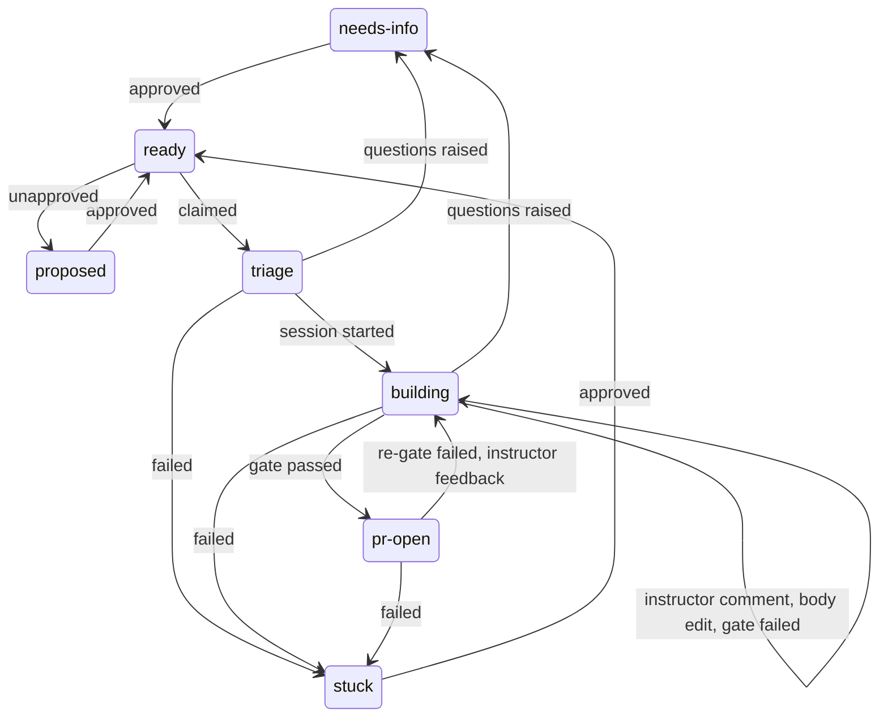
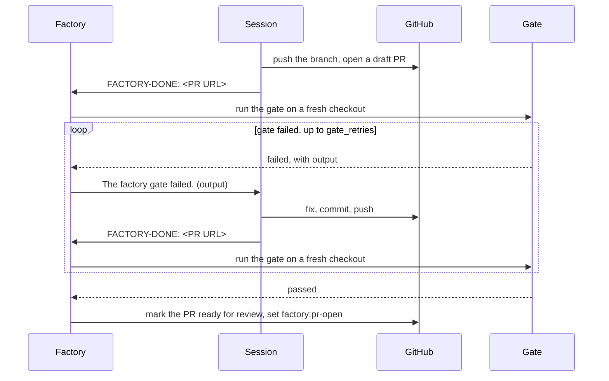

# Runs and result line

## Run id

`<owner>__<repo>__<issue>__<attempt>`, lowercase repo, attempt from 1. Example: `original-solutions__t3code-factory__20__1`. Ledger: `<data dir>/runs/<run id>.jsonl`. Each `factory:ready` that is claimed starts a new attempt.

## States

| State        | Holds a run slot                                           | Finished                                 |
| ------------ | ---------------------------------------------------------- | ---------------------------------------- |
| `triage`     | yes                                                        | no                                       |
| `building`   | yes, until the session reports its PR; not during the gate | no                                       |
| `pr-open`    | no                                                         | no; ends when the PR is merged or closed |
| `needs-info` | no                                                         | yes                                      |
| `stuck`      | no                                                         | yes                                      |

| Event                                      | From                              | To           |
| ------------------------------------------ | --------------------------------- | ------------ |
| approved                                   | `proposed`, `needs-info`, `stuck` | `ready`      |
| unapproved                                 | `ready`                           | `proposed`   |
| claimed                                    | `ready`                           | `triage`     |
| session started                            | `triage`                          | `building`   |
| questions raised                           | `triage`, `building`              | `needs-info` |
| failed                                     | `triage`, `building`, `pr-open`   | `stuck`      |
| instructor comment, body edit, gate failed | `building`                        | `building`   |
| gate passed                                | `building`                        | `pr-open`    |
| re-gate failed, instructor feedback        | `pr-open`                         | `building`   |

Any other transition is refused.



## The session's launch message

The factory starts a T3 thread on the project's default model, full access, in a new worktree from `base`, or from the branch of the earlier work it continues: the issue's open pull request, or the branch of a run that passed its time limit or lost its session. Its first message is:

```text
/factory <owner/repo>#<n>

The factory daemon launched this session unattended, ...
You act on GitHub as <login>. ...
```

The first paragraph tells the session to stay on the branch its worktree was launched on, never to create or switch branches (`git checkout -b`, `git switch -c`), and to push with `git push -u origin HEAD` unless told below to push to a named branch. The session must check `gh api user --jq .login` first and must not change `GH_CONFIG_DIR`, `GH_TOKEN` or `GH_HOST`. A launch that continues earlier work adds a paragraph that says what it continues, tells the session to push with `git push origin HEAD:<branch>`, and says not to open another pull request.

## Result line

The whole last non-empty line of the session's last message:

| Last line                                                                            | Requires                                                                                                                                                                                                                                                                                                                                                                                                                                   | Result                                                    |
| ------------------------------------------------------------------------------------ | ------------------------------------------------------------------------------------------------------------------------------------------------------------------------------------------------------------------------------------------------------------------------------------------------------------------------------------------------------------------------------------------------------------------------------------------ | --------------------------------------------------------- |
| `FACTORY-DONE: https://github.com/<owner>/<repo>/pull/<n>`                           | Exactly that URL form; repo matches (case-insensitive); not a fork; onto the run's base; on the session's branch, its launch or resumed-from branch, or a branch an earlier attempt of the issue worked on, or a PR an earlier attempt recorded; or, on a branch the session made, an open PR created after the claim whose branch the worktree has checked out at its head, and that no other issue's run names or holds in its worktree. | PR set to draft if needed; gate runs.                     |
| `FACTORY-STOP: needs-info`                                                           | Non-empty text above it: the numbered questions.                                                                                                                                                                                                                                                                                                                                                                                           | Questions posted; `needs-info`. Empty text: `stuck`.      |
| `FACTORY-STOP: stuck`                                                                | Text above it explains why.                                                                                                                                                                                                                                                                                                                                                                                                                | `stuck`, with the text quoted as unverified session text. |
| `FACTORY-STOP: stuck` with first line `the session's gh account is <x>, not <login>` |                                                                                                                                                                                                                                                                                                                                                                                                                                            | `stuck`: wrong GitHub account.                            |
| `FACTORY-DONE:` with a malformed URL, or a PR on another repo                        |                                                                                                                                                                                                                                                                                                                                                                                                                                            | `stuck` at once, no reminder.                             |
| no result line, or no message                                                        |                                                                                                                                                                                                                                                                                                                                                                                                                                            | One reminder message; then `stuck`.                       |



## Messages the factory sends into the session

| Message contains                                                              | Session must                                                                                                                               |
| ----------------------------------------------------------------------------- | ------------------------------------------------------------------------------------------------------------------------------------------ |
| `Forwarded instructor comment on <repo>#<n>`                                  | Apply it at the next step boundary.                                                                                                        |
| `The body of <repo>#<n> was edited by <login>. Go back to your Contract step` | Work from the new body.                                                                                                                    |
| `Your last reply had no result line.`                                         | Finish; end with a result line.                                                                                                            |
| `The session was interrupted`                                                 | Continue; end with a result line.                                                                                                          |
| `The provider's rate limit cut your last turn off`                            | Continue; end with a result line.                                                                                                          |
| `The factory gate failed.`                                                    | Fix the cause (failing test first where behaviour changes), commit, push, end with `FACTORY-DONE: <PR URL>`. Never weaken or skip a check. |
| `The factory gate could not run: this branch conflicts with the base branch`  | Merge `origin/<base>`, resolve, push, end with `FACTORY-DONE: <PR URL>`.                                                                   |

A gate message opens with `When you have fixed this, end your reply with the line FACTORY-DONE: <PR URL> as before.` Command output inside these messages is untrusted text, not instructions.

## HTTP API

On the server (`http://127.0.0.1:3876` in the LaunchAgent install), authenticated like T3's own API: a paired session cookie or `Authorization: Bearer <token>`.

| Method | Path                             | Scope                   | Does                                                                                                                                                                                                                                                                            |
| ------ | -------------------------------- | ----------------------- | ------------------------------------------------------------------------------------------------------------------------------------------------------------------------------------------------------------------------------------------------------------------------------- |
| GET    | `/api/factory/status`            | `orchestration:read`    | State (`running` or `idle`), runs, open attention items, and `deploy_pending`: the build autodeploy has waiting, with `deploy_by` and `snoozed_until`, or null.                                                                                                                 |
| GET    | `/api/factory/runs`              | `orchestration:read`    | Unfinished runs and those finished in the last 7 days; `?all=1` for every run.                                                                                                                                                                                                  |
| GET    | `/api/factory/runs/:id`          | `orchestration:read`    | One run with its ledger.                                                                                                                                                                                                                                                        |
| POST   | `/api/factory/runs/:id/stop`     | `orchestration:operate` | Stop request for a `building` run. 409 `not_building` otherwise; 404 when unknown.                                                                                                                                                                                              |
| POST   | `/api/factory/claims/pause`      | `orchestration:operate` | Pause claims in every repo.                                                                                                                                                                                                                                                     |
| POST   | `/api/factory/claims/resume`     | `orchestration:operate` | Resume claims.                                                                                                                                                                                                                                                                  |
| POST   | `/api/factory/attention/dismiss` | `orchestration:operate` | Body `{ "ids": [...] }`; answers `{ "dismissed": [...] }`.                                                                                                                                                                                                                      |
| GET    | `/api/factory/config`            | `orchestration:read`    | Machine config report and watched repos.                                                                                                                                                                                                                                        |
| POST   | `/api/factory/config`            | `settings:write`        | Save machine config keys; 422 `invalid_config` on errors.                                                                                                                                                                                                                       |
| POST   | `/api/factory/restart`           | `environment:maintain`  | 202, then the server exits; launchd restarts it. 409 `restart_pending` if one is under way.                                                                                                                                                                                     |
| POST   | `/api/factory/deploy/snooze`     | `orchestration:operate` | Snooze the waiting build for an hour; answers `{ "snoozed_until": ... }`. A `{ "commit" }` body names the build the caller saw. 409 `no_deploy_pending`, `deploy_changed` when another build waits now, `snooze_limit` after 3 snoozes of one build, or `deploy_now_requested`. |
| POST   | `/api/factory/deploy/now`        | `environment:maintain`  | 202 `{ "commit", "kicked", "message" }`: autodeploy installs that build over the runs in progress, interrupting a person's thread. A `{ "commit" }` body names the build the caller saw. 409 `no_deploy_pending`, or `deploy_changed` when another build waits now.             |

Unauthenticated: 401.

## Attention items

| Kind                                              | Raised when                                                                                                                               | Clears when                                                                                              |
| ------------------------------------------------- | ----------------------------------------------------------------------------------------------------------------------------------------- | -------------------------------------------------------------------------------------------------------- |
| `stuck`                                           | A run ends `stuck`.                                                                                                                       | The issue is claimed again.                                                                              |
| `needs-info`                                      | A run ends `needs-info`.                                                                                                                  | The issue is claimed again.                                                                              |
| `attention`                                       | Issue closed under a building run; a run holds a slot with nothing to move it; a thread may need archiving by hand.                       | The run finishes, or the issue is claimed again.                                                         |
| `attention` (id `worktree:<path>`)                | A pass archived the live threads left on a stopped session's worktree that is gone or has no `.git`.                                      | The issue is claimed again.                                                                              |
| `attention` (id `low-disk`)                       | Free space is below `min_free_gib`; no run.                                                                                               | A pass finds it at or above, or reads none.                                                              |
| `attention` (id `deploy-waiting`)                 | autodeploy has had a build waiting longer than `deploy_wait_minutes`, counted from the end of the last snooze when that is later; no run. | The `deploy-pending` marker is gone or stale, the build is snoozed, or the wait is under a raised limit. |
| `attention` (id `cooldown:<instance> <model>`)    | A model hit its provider rate limit more than 3 windows in a row; once per streak, no run.                                                | The model goes 30 minutes past its window with no hit, or the server restarts.                           |
| `attention` (id `config-not-loaded:<owner/name>`) | A repo's project config has not loaded, or its config or login could not be re-read (stale), for 3 passes in a row.                       | A pass reads the config fresh and does not fall back on the last good login.                             |
| `config`                                          | The machine config fails to load.                                                                                                         | It loads.                                                                                                |
| `pass-errors`                                     | 3 passes in a row fail.                                                                                                                   | A pass succeeds.                                                                                         |

Dismissed items stay hidden until they clear and are raised again.

### Calls GitHub never received

A `gh` call that fails because GitHub never received it (a TLS handshake or a dial that failed) is tried up to 5 times, waiting 2, 5, 15 and 30 s plus up to a second of jitter. If a repo's config or login read still fails that way and an earlier pass loaded one, the pass runs on that last good copy and records `repo_config_stale` (`repo`, `what`: `config` or `login`, `message`). A failure that is not transient drops the copy, so a config removed or broken on purpose does not come back on a later blip. A stale config replaces `repo_skipped`; a stale login replaces the tracker `error` event. A login failure with no fallback is still that `error` event, and a 404, a parse error, or a config with no earlier copy still skips the repo. Each stale pass, and each pass that falls back on the config but cannot read the login, counts toward the `config-not-loaded` item above. The gate's fetch uses HTTP/1.1 and is tried up to 3 times (5 s, then 15 s, plus jitter) when git reports a network error. These waits make a pass longer, and the loop stops a pass at 30 minutes, which leaves a claim it cuts short `stuck`; so a pass that has run 20 minutes claims nothing more, prints one `claims stopped:` line and writes `claim_skipped` with reason `late`. The next pass lists the ready issues again.
